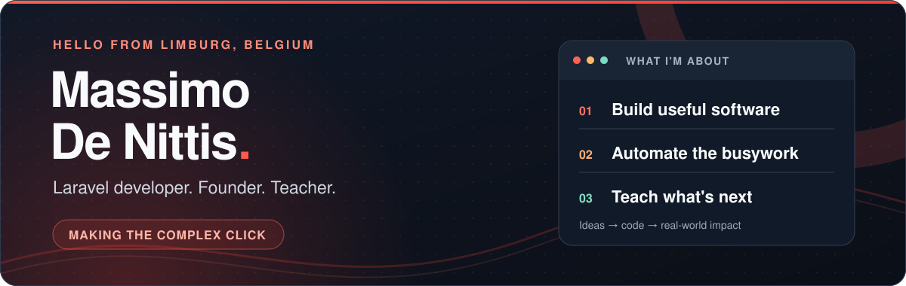

  
  
  

### Hey, I'm Massimo. 👋

I'm a Laravel developer, founder and teacher in **Limburg, Belgium**. I run **Assurio BV**, a one-person software company, and turn messy business problems into useful, human-friendly software.

> **Less busywork. More building.** Good software should give people time back—not another thing to wrestle with.

## ⚡ What keeps me busy

**🏗️ Building for the real world** I create custom Laravel applications and build [Assurio](https://assurio.be), a multi-tenant SaaS for Belgian insurance brokers. From the first conversation to the final deployment, the people using the software stay at the center.

**🤖 Making AI earn its place** I put AI into actual workflows, where it can take repetitive work off someone's plate. Less demo magic, more practical results.

**🎓 Passing it on** At [SyntraPXL](https://www.syntrapxl.be) in Genk, I teach full stack AI automation, Laravel and React, as well as courses on vibe coding and applied LLM agents.

## 🧰 The toolbox

  
  
  
  
  
  
  
  
  

**Laravel ecosystem:** Filament · Livewire · Inertia **Frontend:** Alpine.js · HTML · CSS **More in the mix:** Express · Supabase · Git · Linux · WordPress · VS Code · GitHub **AI tools:** Claude Code · Cursor

## 🧭 How I work

**Listen → explore → build → ship.** I start with the people, the code and the data; work in small steps; and put staging before production. I'm always happy to talk Laravel architecture, multi-tenancy and CI/CD.

## 🔥 Keeping the streak alive

  

## 🚀 Let's make something useful

Have a Laravel project, an AI idea, or a workflow that deserves better? Say hello on [LinkedIn](https://www.linkedin.com/in/assuriobv) or find me at **[assurio.be](https://assurio.be)**.
