  
  
  

## About me

I'm Massimo, and I run **Assurio BV**, a one-man software company in Zonhoven. Most days I'm building custom Laravel applications for clients or working on **[Assurio](https://assurio.be)**, my multi-tenant SaaS for Belgian insurance brokers.

These days a lot of that work involves AI. Not demos, but features inside real workflows where people notice the time they get back. I like sitting close to the client and understanding the problem before the first migration gets written.

I also teach Full Stack Web Development at SyntraPXL in Genk.

## Toolbox

<table>
  <tr>
    <td width="130"><b>Backend</b></td>
    <td>
      
      
      
      
    </td>
  </tr>
  <tr>
    <td><b>Frontend</b></td>
    <td>
      
      
      
      
      
      
      
    </td>
  </tr>
  <tr>
    <td><b>Data and ops</b></td>
    <td>
      
      
      
      
      
    </td>
  </tr>
  <tr>
    <td><b>Web and tools</b></td>
    <td>
      
      
      
    </td>
  </tr>
  <tr>
    <td><b>Also daily</b></td>
    <td>
      
      
      
      
      
    </td>
  </tr>
</table>

## What I'm up to

- Shipping new modules for [Assurio](https://assurio.be), with AI doing the boring parts of a broker's day
- Teaching a Full Stack traject with Laravel and React, plus evening courses on vibe coding and applied LLM agents
- Happy to talk about multi-tenancy, Laravel architecture or CI/CD with GitHub Actions

I start every job with recon: read the code, look at the data, talk to the people who use it. Then small steps, staging first, production last.

## Activity

  

## Get in touch

Got a Laravel project, or want AI inside an application you already have? Find me on [LinkedIn](https://www.linkedin.com/in/YOUR-LINKEDIN-HANDLE) or via [assurio.be](https://assurio.be).
